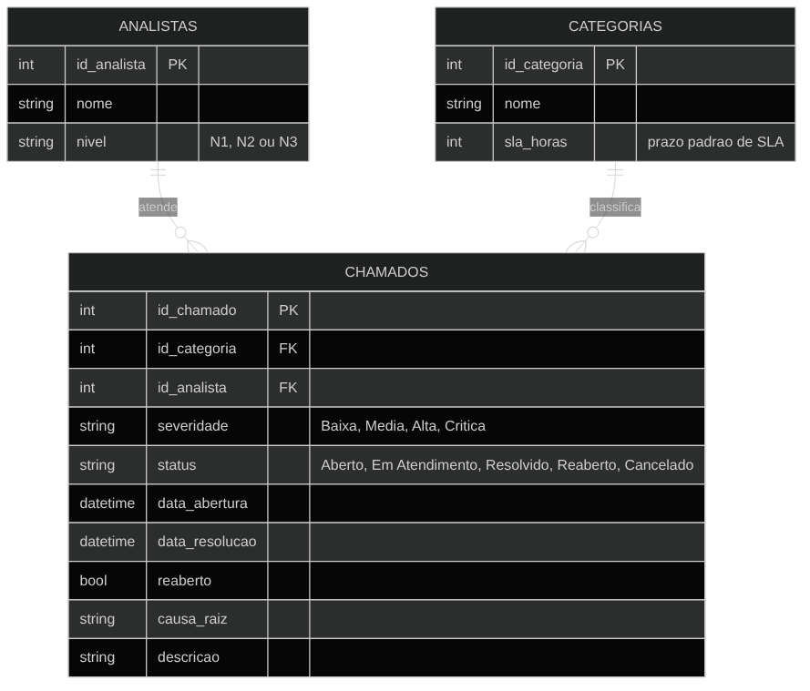

# 🎫 Service Desk Dashboard

[](https://github.com/euguisantosdev/service-desk-dashboard/actions/workflows/tests.yml)

Simulação de um ambiente real de suporte técnico (service desk): banco de
chamados em SQL, queries de análise, automação de alerta de SLA e um
dashboard interativo em Streamlit.

O projeto nasce da minha experiência direta em suporte N1/N2/N3 e
sustentação de sistemas — a estrutura de dados (categorias, SLA,
severidade, reabertura, causa raiz) reflete o que um analista de suporte
lida todo dia.

## O que o projeto mostra

- **Modelagem de dados em SQL** — schema normalizado para chamados,
  categorias e analistas (`sql/schema.sql`).
- **Análise de dados via SQL** — 9 queries que respondem perguntas reais
  de gestão de service desk: SLA cumprido vs. estourado, taxa de
  reabertura, tempo médio de resolução, causas raiz recorrentes,
  produtividade por analista (`sql/queries_analise.sql`).
- **Automação** — script que varre os chamados em aberto e gera um
  relatório de risco de SLA, simulando o alerta que dispararia por
  e-mail/Slack em um cenário real (`automacao/alerta_sla.py`).
- **Dashboard interativo** — painel em Streamlit com KPIs, filtros e
  gráficos, consumindo direto do banco (`app/dashboard.py`).

## Modelo de dados



## Estrutura

```
service-desk-dashboard/
├── README.md
├── requirements.txt
├── requirements-dev.txt        # dependências extras para rodar os testes
├── sql/
│   ├── schema.sql              # modelagem das tabelas
│   └── queries_analise.sql     # 9 queries de análise
├── data/
│   └── gerar_dados_ficticios.py   # gera o banco SQLite com dados fictícios
├── automacao/
│   └── alerta_sla.py           # gera relatório de chamados em risco de SLA
├── app/
│   └── dashboard.py            # dashboard Streamlit
├── tests/                      # testes automatizados (pytest)
├── .github/workflows/
│   └── tests.yml               # roda os testes a cada push (GitHub Actions)
├── docs/
│   └── schema.png              # diagrama ER do banco
└── screenshots/
    └── dashboard.png
```

## Como rodar localmente

Pré-requisito: Python 3.10+.

```bash
# 1. clonar o repositório
git clone https://github.com/euguisantosdev/service-desk-dashboard.git
cd service-desk-dashboard

# 2. instalar dependências
pip install -r requirements.txt

# 3. gerar o banco com dados fictícios (cria data/service_desk.db)
python data/gerar_dados_ficticios.py

# 4. (opcional) gerar o relatório de alerta de SLA
python automacao/alerta_sla.py

# 5. subir o dashboard
streamlit run app/dashboard.py
```

O dashboard abre automaticamente em `http://localhost:8501`.

## Rodando os testes

```bash
pip install -r requirements-dev.txt
pytest tests/ -v
```

Os testes rodam automaticamente a cada push via GitHub Actions
(`.github/workflows/tests.yml`) — o badge no topo deste README mostra o
status da última execução. Eles cobrem: geração dos dados fictícios,
validade de todas as 9 queries de análise, e a lógica do script de alerta
de SLA — incluindo um teste de regressão para um bug real que já aconteceu
neste projeto (chamados em aberto se concentrando artificialmente em um
único dia no gráfico de volume).

## Ver sem instalar nada

🔗 **[Abrir o dashboard publicado](https://service-desk-dashboard-8qhpzeyamo75tk9qklbfjw.streamlit.app/)**

O app gera o banco de dados fictício automaticamente na primeira execução,
então o link acima já abre com os dados prontos — sem precisar clonar nada.

## Dados

Todos os dados são fictícios, gerados por `data/gerar_dados_ficticios.py` —
não há nenhum dado real de cliente ou empresa aqui. Mas o *modelo* por trás
deles (as categorias, os níveis de SLA, as causas raiz, a proporção de
reabertura) não foi inventado aleatoriamente: reflete o que eu via no dia a
dia atendendo suporte N1/N2/N3 — categorias como "Acesso/Senha" e
"Impressora" com SLA curto, "Sistema Interno Legado" e "Banco de
Dados/SQL" com SLA mais longo e maior taxa de reabertura, chamados críticos
sendo atendidos mais rápido mas ainda assim estourando SLA numa fração
realista dos casos.

A geração segue regras propositalmente realistas (severidades mais altas
tendem a ser resolvidas mais rápido, categorias mais complexas reabrem
mais, nem todo chamado "em aberto" está estourando o SLA, o backlog de
chamados em aberto fica espalhado pelos últimos dias em vez de
concentrado artificialmente em um único dia) e é coberta por testes
automatizados que travam essas regras — ver `tests/test_gerar_dados.py`.
A seed é fixa (`random.seed(42)`), então qualquer pessoa que rodar o
script gera exatamente o mesmo banco.

## Por que esse projeto

Depois de atender em média 110 clientes/dia em suporte técnico, o que me
faltava não era saber atender — era conseguir mostrar, com dado, onde o
processo trava. Esse projeto é essa pergunta respondida: em vez de um
CRUD genérico, é a modelagem e a análise de um problema que eu já vivo na
prática.

---
Guilherme dos Santos Bueno — Sorocaba/SP
